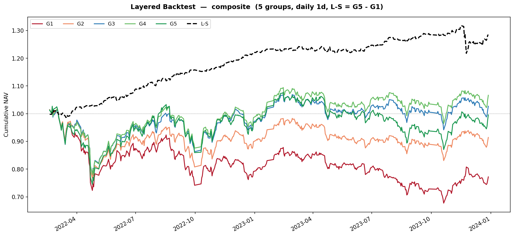
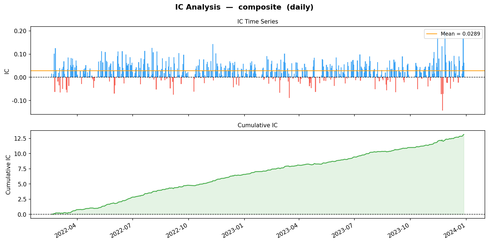
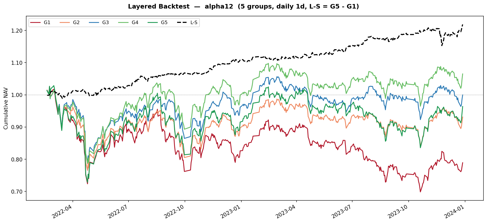
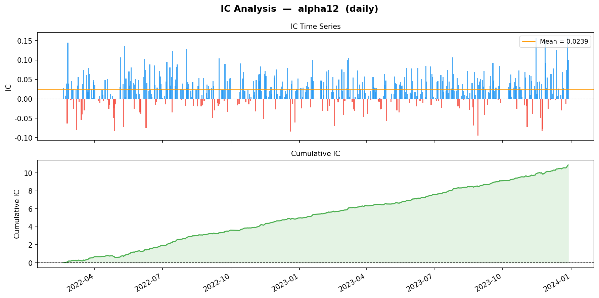

# factor_lite

本地精简复现，不直接跑 Parsnip77。

## 复现范围

复现的是 Parsnip77 的评估框架（截面 RankIC、五组等权、多空），因子只留了 3 个能讲清的 Alpha101：Alpha#6、Alpha#12、Alpha#23，嵌套层数多的因子没有做。

只选这 3 个，是因为每个都能用一句话说明它在赌什么；一句话说不清的公式这次不复现。

评估与仓库阶段 2 对齐：**日频调仓、持有 1 天、不扣手续费**。这三个因子窗口偏短，月持有会造成 horizon 错配，故不用月频。

跑 `python my_evaluate.py` 或 `python my_combine.py` 后，图写到 `plots/`：`{因子}_ic.png`（日度 IC + 累计 IC）、`{因子}_backtest.png`（G1…G5 + L-S）。

## 结果与归因

样本：清洗因子为 2021-01 至 2023-12 的全市场日频。合成权重要用过去 252 个交易日的 RankIC，下表只含权重大于零的交易日，共 455 天。

RankIC 是日度截面 Spearman。多空年化、夏普、最大回撤都基于不扣费的日收益。夏普按日收益均值 / 标准差 × √252，无风险利率取 0。

| 因子 | RankIC | 多空年化 | 夏普 | 最大回撤 |
|------|-------:|---------:|-----:|---------:|
| alpha6 | 0.017 | 11.9% | 1.83 | -6.7% |
| alpha12 | 0.024 | 11.6% | 2.10 | -4.6% |
| alpha23 | 0.017 | 7.4% | 0.92 | -7.8% |
| composite | 0.029 | 14.9% | 2.24 | -7.5% |

单因子里 RankIC 最高的是 alpha12（0.024）。composite 的 RankIC 是 0.029，比 alpha12 高大约 0.005；多空年化是 14.9%，也高于三个单因子。夏普最高的是 composite（2.24），其次是 alpha12（2.10）。这些数字都不扣交易费用，日频满换手若扣费会差一截，不能当实盘预期。

### 结果图（示例）

合成因子分层回测（G1…G5 与多空 L-S）与 IC：

单因子里表现最好的 alpha12：

其余因子图在 `plots/`：`alpha6_*`、`alpha23_*`。

### 已知局限

行业用的是 Tushare `stock_basic` 的当前快照，不是历史上每一天的行业，中性化会带进前视偏差。三个因子没有做相关性或共线性检查；合成用的是滚动 IC 加权，不是把因子放进回归。也没有做组合层的风险归因，结果停在因子评估这一层。日频不扣费，成绩偏乐观。
